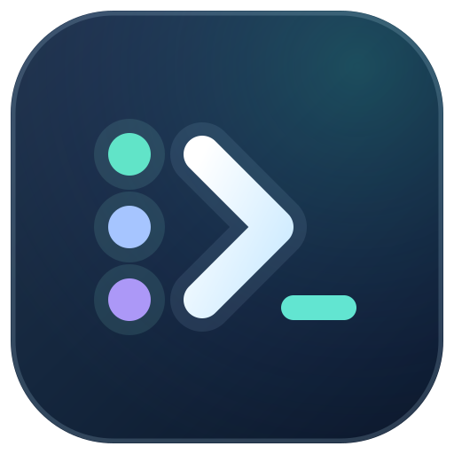

# Codex Pool

本地 Codex 多账户模型访问代理。**Codex owns the workflow. The proxy only owns model access.**

## 当前状态（2026-10-14）

| 范围 | 状态 |
|------|------|
| Daemon（`127.0.0.1:3210`）+ localhost Dashboard | 已实现，可本地运行 |
| Windows Widget 托盘面板（可固定） | 已实现；完整桌面验收仍待完成 |
| 原生多账户（登录、独立 refresh、真实 5h/weekly 额度、小会话续接与阈值自动切换） | **核心已通过**，**不等于完整发布验收** |
| ChatGPT Desktop 接入 | **仍待验收** |
| macOS 客户端 | **源码原型**，未通过 Mac 编译/真机验收 |
| 生产默认自动切换 | **关闭**（需显式实验开关） |

验收细节见 [docs/native-acceptance-results.md](docs/native-acceptance-results.md)。不要把小会话通过当成完整发布门槛已清。

### 已合入的本轮功能

以下改动已于 2026-10-14 分别通过 Squash Merge 合入 `master`：

| PR | 主题 | 说明 |
|----|------|------|
| [#6](https://github.com/AliceJump/codex-muti/pull/6) | Responses 请求头与产品名 | 透传两种 session/thread 拼写，metadata 会话身份与缓存亲和性分开 |
| [#8](https://github.com/AliceJump/codex-muti/pull/8) | 玻璃托盘菜单 | 修复关闭重入、DPI 坐标和主题继承 |

合入源代码与本机实际运行的构建可能不同；真实多账户、Desktop 和完整桌面验收仍以验收报告为准。
## 组件与端口

| 组件 | 作用 | 默认地址 / 入口 |
|------|------|-----------------|
| **Daemon** | 模型代理、账户、额度、本地 API、Dashboard 静态页 | `http://127.0.0.1:3210`（仅 loopback） |
| **Dashboard** | 浏览器账户/额度/阈值控制台 | 同端口；`pool.ps1 dashboard` 建立短期安全会话 |
| **Widget** | 可固定和拖动的托盘账户面板 | `pool.ps1 widget` / `Ctrl+Alt+W` |
| **代理控制托盘** | 独立图标，启动／关闭代理、打开账户浮窗 | `scripts/start-proxy-tray.ps1` |

Daemon 本身不依赖 Node。协议基准为官方 Codex CLI `0.157.1`（Node 22 仅用于验证脚本/MCP 夹具）。

## 快速开始

发行包从 [GitHub Releases](https://github.com/AliceJump/codex-muti/releases) 下载 Windows x64 ZIP，完整解压后双击 **CodexPool.exe**，无需安装 .NET 或 PowerShell 7。原生账户登录仍需要官方 Codex CLI；数据保存在 LocalAppData，升级与使用见 [发行包说明](docs/windows-package.md)。

当前正式版：[v0.1.4](https://github.com/AliceJump/codex-muti/releases/tag/v0.1.4)。

从源码运行需要 Windows 11、.NET 10 SDK 和官方 Codex CLI。

```powershell
dotnet build CodexPool.slnx
dotnet run --project src/CodexPool.Daemon --no-launch-profile -- serve
```

便捷命令：

```powershell
.\scripts\pool.ps1 start
.\scripts\pool.ps1 dashboard
.\scripts\pool.ps1 widget
```

### 登录账户

每个账户用系统浏览器完成官方 Continue with ChatGPT；不要复制 token，也不要覆盖用户默认的 Codex `auth.json`。

```powershell
dotnet run --project src/CodexPool.Daemon --no-launch-profile -- login "Account A"
dotnet run --project src/CodexPool.Daemon --no-launch-profile -- login "Account B"
dotnet run --project src/CodexPool.Daemon --no-launch-profile -- status
dotnet run --project src/CodexPool.Daemon --no-launch-profile -- models
```

原生 5h/weekly 额度适配器用：

```powershell
dotnet run --project src/CodexPool.Daemon --no-launch-profile -- native-login "Native Account A"
dotnet run --project src/CodexPool.Daemon --no-launch-profile -- native-login "Native Account B"
```

详情见 [docs/native-auth-adapter.md](docs/native-auth-adapter.md)。原有 SIWC 注册会保留；SIWC token 只走公开路线，额度仍显示未知。

首次成功授权成为 active；其余保持独立登录。控制命令：`activate` / `pause` / `resume` / `drain` / `undrain` / `enable` / `disable`（ID 来自 `status`）。暂停/排空/禁用只挡后续请求，已接受的流继续用原账户。

### 可选 CLI wrapper

```powershell
Set-Alias mcodex (Join-Path $PWD 'scripts\mcodex.ps1')
mcodex -m gpt-6-luna
```

Wrapper 只提供 custom provider 配置和本地代理凭证，不接管 session、工具、上下文或 Git。默认连接 `http://127.0.0.1:3210/v1`，关闭 WS。OAuth 凭据只留在 Daemon。

## Codex / Desktop 配置（`~/.codex/config.toml`）

使用内置 OpenAI provider 时，先仅在用户级配置顶层设置模型入口，登录与用量查询保留官方后端：

```toml
openai_base_url = "http://127.0.0.1:3210/v1"
```

| 键 | 作用 |
|----|------|
| `openai_base_url` | 模型请求转到本机池（`master` 已支持相关入口说明） |

模型入口可接受池内原生 access token，或只读核对 Daemon `CODEX_HOME/auth.json` 中的当前 ChatGPT 登录；代理不导入、复制、刷新或写入该文件。实际上游账户仍由 sticky 调度决定。

原生 WebSocket 探测返回 426，使 Codex 回落 HTTP/SSE。`/v1/models` 返回原生目录；带 `client_version` 时优先原样转发。支持原生 zstd（入口及解压后的请求体上限均为 128 MiB，解码窗口上限保持 32 MiB）。错误汇总见 [docs/model-errors.md](docs/model-errors.md)；provider 验收见 [docs/local-provider-acceptance.md](docs/local-provider-acceptance.md)。

## 本地组合部署

双击 `deploy.cmd` 可选择全部、仅核心或仅桌面组件。核心包含代理和 Dashboard；桌面组件为支持固定的托盘面板。

```powershell
pwsh -NoProfile -File .\scripts\deploy-local.ps1 -Dashboard
# 只更新界面，保留核心进程和进行中的模型请求：
pwsh -NoProfile -File .\scripts\deploy-local.ps1 -Target Components
# 只更新核心，保留现有界面：
pwsh -NoProfile -File .\scripts\deploy-local.ps1 -Target Core -Dashboard
# 命令行一键入口也可指定：
.\deploy.cmd Components
```

只构建并启动、保留已有 Daemon：

```powershell
.\scripts\build-and-start.ps1
.\scripts\build-and-start.ps1 -Dashboard
```

说明：

- 部署脚本只动本仓库（及 worktree）`.local` 下的代理与 UI；不改账户凭据/阈值，不停止 Codex 本身。
- 全部或核心部署会中断经过代理的当前请求；仅组件部署不停止、启动或替换核心。首次安装需选择全部。
- 部分部署只发布所选项目，未选组件从现有完整版本保留；成功后记录完整组合版本。所选新进程启动失败时尝试恢复旧版，并保留原版本指针。
- 本机运行版本以实际部署构建为准；更新源码不会自动替换已经运行的 Daemon。
- #6 / #7 / #8 已分别合入 `master`，无需组合草稿分支。

账户改名：`pool.ps1 rename <account-id> "新名称"` 或 Dashboard 卡片操作，见 [docs/account-rename.md](docs/account-rename.md)。

## 桌面端：Widget、Mac

### Windows Widget

- Widget：固定透明宿主，完整/紧凑/胶囊连续形变；点击标题栏图钉保持置顶并允许拖动，取消固定后恢复失焦收起。固定状态和位置随布局、主题保存。当前使用透明着色材质，真实 Acrylic 模糊留待独立验收。
- 完整账户卡片与 Dashboard 显示订阅截止时间（含时区偏移），按查看设备的本地时区转换。截止时间读取已保存 ID token 的 `chatgpt_subscription_active_until`，随登录与令牌刷新更新；上游未提供时显示“订阅截止时间未知”。
- 只有一个托盘面板实例；不再提供独立悬浮窗入口。× / Alt+F4 只隐藏面板，托盘菜单“退出托盘面板”退出 UI，Daemon 继续运行。胶囊态可通过托盘菜单固定/取消固定。
- 使用小组件快捷方式或 `open-widget.ps1` 启动；没有代理时可自动拉起 Daemon，完整真实验收仍以报告为准。
- 托盘右键玻璃菜单（与面板同主题）已在 [PR #8](https://github.com/AliceJump/codex-muti/pull/8) 合入。

详见 [docs/desktop-widget.md](docs/desktop-widget.md)。

独立代理控制图标见 [docs/proxy-tray.md](docs/proxy-tray.md)。代理图标负责服务状态与启停，数字额度图标负责账户、自动切换、额度、历史用量及浮窗。两者可以互相打开，已有客户端复用原实例；退出任一界面都保留代理服务，代理图标的“关闭代理”才停止服务。

### macOS 原型

源码在 `src/CodexPool.Widget.Mac/`，构建脚本 `scripts/build-widget-mac.sh`。**尚未** Mac 编译/真机验收；Daemon 仍依赖 Windows DPAPI，Mac Keychain 适配未做。Windows 不能直接跑原生 `.app`。

## 本地状态与安全（摘要）

- 数据：`%LOCALAPPDATA%\CodexPool`，DPAPI CurrentUser；无明文凭据回退。
- 单 Daemon 独占锁；刷新按注册单飞，成功后原子替换凭据。
- 默认仅 loopback；Host/Origin、HttpOnly 会话与 CSRF 保护控制 API。
- `/health` 公开；`/status`、`/accounts`、`/usage`、`/models` 与控制/模型请求需本地鉴权。
- 原生 `/usage` 按真实窗口时长展示；SIWC 为未知。Token 统计见 [docs/usage-statistics.md](docs/usage-statistics.md)。

## 验证

```powershell
dotnet run --project tests/CodexPool.Tests
dotnet run --project tests/CodexPool.SecurityTests
node scripts/phase0-smoke.mjs
```

SecurityTests 会占用 `3210`，请先停正在跑的 Daemon。产物只写忽略目录 `.research/`。

真实双账户实验需显式测试模式与两次登录：

```powershell
dotnet run --project src/CodexPool.Daemon --no-launch-profile -- serve --live-boundary-probe
node scripts/phase0-live.mjs
```

部署请用普通 `serve`，不要长期开实验开关。请求一旦开始交付正文即不可跨账户重放。

## 打包

```powershell
.\scripts\build-release.ps1
.\scripts\build-release.ps1 -SelfContained
```

产物在 `.local\release`。仍需官方 Codex CLI。

## 文档索引

- [architecture.md](architecture.md) — 责任边界与协议安全
- [implementation-plan.md](implementation-plan.md) — 分阶段门槛
- [docs/phase0-results.md](docs/phase0-results.md) — Phase 0 已通过 / 待验证
- [docs/native-acceptance-results.md](docs/native-acceptance-results.md) — 原生多账户验收范围
- [docs/native-auth-adapter.md](docs/native-auth-adapter.md) — 原生登录与额度适配
- [docs/desktop-widget.md](docs/desktop-widget.md) — Widget / Mac
- [docs/model-errors.md](docs/model-errors.md) — 错误与账户池汇总
- [docs/local-provider-acceptance.md](docs/local-provider-acceptance.md) — 本地 provider 验收

用量与请求历史长期保存在本地，重启代理后仍可查看，详见 [用量统计](docs/usage-statistics.md)。

旧版本如配置过本地 `chatgpt_base_url`，升级时请移除此项并重启 Codex，恢复使用官方 ChatGPT 后端；模型入口继续使用 `openai_base_url`。本地用量改写、3211 HTTPS 后端及客户端压缩桥接已移除。一键入口 `start-codex.cmd` 现在启动代理、托盘及官方 Codex Desktop。
